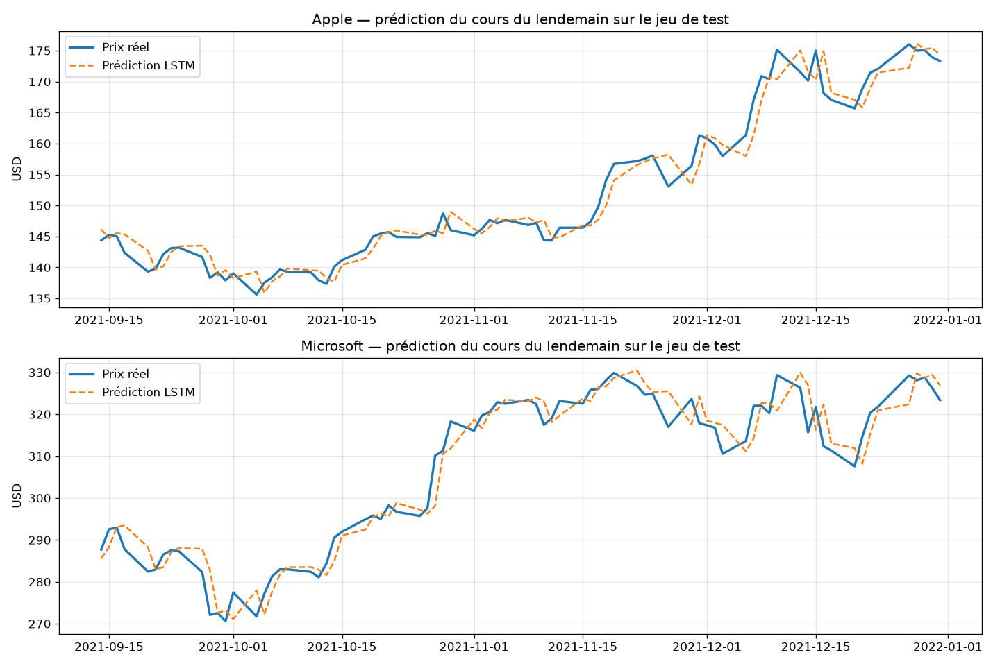

# Prévision du cours boursier d'Apple et de Microsoft avec un LSTM

Projet de Deep Learning (Pr. Benbrahim) — Ahmed Douyry.

**Architecture choisie :** LSTM (catégorie « LSTM / GRU »), implémenté avec PyTorch.

**Objectif :** à partir des 30 derniers jours de cotation, prédire le cours de clôture du jour suivant
pour les actions Apple (AAPL) et Microsoft (MSFT).

## Données

| Fichier | Contenu |
|---|---|
| `data/AAPL_2020_2021.csv` | Apple, 505 jours de cotation, du 02/01/2020 au 31/12/2021 |
| `data/MSFT_2020_2021.csv` | Microsoft, 505 jours de cotation, du 02/01/2020 au 31/12/2021 |

Colonnes : `Date, Open, High, Low, Close, Adj Close, Volume` (prix en USD).

**Source :** Yahoo Finance, téléchargé avec la bibliothèque Python [`yfinance`](https://pypi.org/project/yfinance/) :
- https://finance.yahoo.com/quote/AAPL/history
- https://finance.yahoo.com/quote/MSFT/history

Les prix d'Apple sont ajustés de la division d'action par 4 du 31/08/2020.

## Structure du projet

```
projet_lstm_bourse.ipynb   notebook principal (déjà exécuté, avec résultats et graphiques)
projet_lstm_bourse.py      même contenu au format script Python
data/                      jeux de données CSV
figures/                   graphiques générés par le notebook
resultats.csv              métriques sur le jeu de test
requirements.txt           dépendances Python
```

## Démarrer le projet

Prérequis : Python 3.10 ou plus récent.

```bash
git clone https://github.com/ahmed-douyry/projet-deep-learning-lstm-bourse.git
cd projet-deep-learning-lstm-bourse

python3 -m venv .venv
source .venv/bin/activate          # Windows : .venv\Scripts\activate

# PyTorch version CPU (plus léger), puis le reste des dépendances
pip install torch --index-url https://download.pytorch.org/whl/cpu
pip install -r requirements.txt
```

Puis, au choix :

```bash
# Ouvrir le notebook dans le navigateur
jupyter notebook projet_lstm_bourse.ipynb

# ou exécuter directement le script (les graphiques sont enregistrés dans figures/)
python projet_lstm_bourse.py
```

L'entraînement des deux modèles prend moins d'une minute sur un processeur classique.

## Méthode

1. **Exploration** des données : statistiques descriptives, évolution des cours et des volumes.
2. **Préparation** : le modèle ne travaille pas directement sur les prix (qui montent fortement en fin de période,
   au-delà de tout ce qui a été vu à l'entraînement) mais sur 4 variables stationnaires : rendement logarithmique,
   amplitude haut/bas, variation ouverture/clôture et variation du volume. Fenêtres glissantes de 30 jours,
   standardisation ajustée sur l'entraînement uniquement.
3. **Découpage chronologique** : 70 % entraînement, 15 % validation, 15 % test (septembre à décembre 2021).
4. **Modèle** : 2 couches LSTM de 64 unités, dropout 0,2, puis une couche dense. Perte MSE, optimiseur Adam,
   early stopping sur la perte de validation.
5. **Évaluation** : comparaison avec un modèle naïf « le prix de demain = le prix d'aujourd'hui ».

## Résultats (jeu de test)

| Action | Modèle | RMSE | MAPE | Précision directionnelle |
|---|---|---|---|---|
| Apple | LSTM | 2,33 $ | 1,14 % | 54,5 % |
| Apple | Naïf | 2,34 $ | 1,14 % | – |
| Microsoft | LSTM | 4,41 $ | 1,09 % | 57,1 % |
| Microsoft | Naïf | 4,44 $ | 1,10 % | – |



Le LSTM suit très bien le prix réel, mais il ne fait qu'à peine mieux que le modèle naïf, et sa précision
directionnelle est proche de la part de jours en hausse dans le test (environ 56 %). Ce résultat est cohérent avec
l'hypothèse d'efficience des marchés : les variations journalières d'actions très liquides sont quasiment
imprévisibles à partir de leur seul historique. Les pistes d'amélioration sont détaillées à la fin du notebook.
